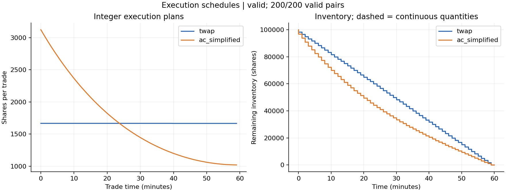
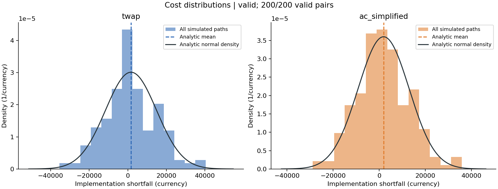
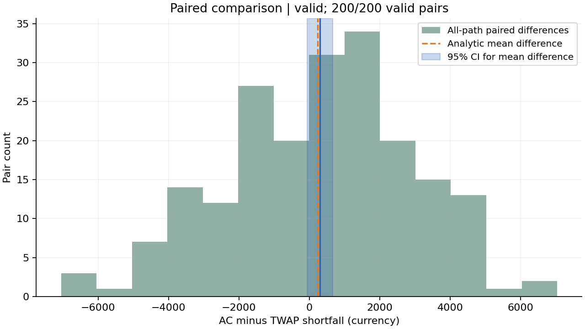

# Trade Execution Cost & Risk Lab — Study Note

## Research question

How does risk-sensitive front-loading change temporary-impact cost and price exposure relative to TWAP?
This experiment uses a simplified Almgren–Chriss-style discrete reference, a custom O(N) Thomas solver, and integer approximations. It does not simulate a live order book.

## Reproducible setup

Software 0.1.0; schema 1.0; model linear_temporary_impact_reference.
Seed: 20261009; status: **valid**; valid pairs: **200/200**.
Invalid pairs: 0. They are preserved and never replaced.

| Parameter | Value |
|---|---:|
| quantity | 100000 |
| duration | 60 |
| intervals | 60 |
| price | 100 |
| volatility | 0.03 |
| impact | 1e-05 |
| risk_aversion | 1e-05 |
| trials | 200 |
| seed | 20261009 |

Both strategies sell on the same synthetic reference-price paths. Every scheduled trade fills at the start of its interval. Integer and continuous plans are separately exported.

## Results for actual integer schedules

| Strategy | Analytic mean | Analytic variance | Analytic J | Sample mean | 95% CI for mean | Sample variance |
|---|---:|---:|---:|---:|---|---:|
| twap | 1,666.67 | 1.75493e+08 | 3,421.6 | 1,514.13 | [-366.634, 3,394.9] | 1.8193e+08 |
| ac_simplified | 1,896.03 | 1.2279e+08 | 3,123.93 | 1,814.91 | [243.089, 3,386.74] | 1.2707e+08 |

Mean shortfall and its interval are in currency; variances are in currency squared.
Confidence intervals use Student-t with sample variance (ddof=1). They measure simulation mean uncertainty.
Paired AC-minus-TWAP: analytic mean 229.364, analytic variance 6.85007e+06; sample mean 300.782; 95% interval [-67.4578, 669.021].

The continuous reference optimizes mean cost plus weighted variance; integer schedules are feasible approximations. Front-loading can increase expected impact cost while reducing exposure risk. Synthetic results do not establish real-market performance. Intervals quantify Monte Carlo mean uncertainty, not real-world forecast uncertainty.

If any path is invalid, the table uses conditional selected valid samples, not unconditional inference. The raw all-path algebraic diagnostics remain in results.json. If fewer than two pairs are valid, inferential metrics are unavailable.

## Assumptions and limits

Prices follow zero-drift arithmetic Brownian motion. Only linear temporary impact is present. No permanent impact, fees, bid–ask spread, queue priority, partial fills or liquidity constraints are represented. Negative costs can arise from favourable price innovations; nonpositive prices flag model invalidity.
Parameters are illustrative, not fitted to market data. The continuous reference minimizes the chosen cost–risk objective; integerization is a feasible approximation and not an exact integer optimum. No real-market superiority is established.

## Verification and provenance

The test suite checks hand calculations, an independent constrained SciPy optimizer, paired accounting, degenerate and invalid cases, and fixed-seed Monte Carlo moment consistency.
Core source SHA-256: 2556be594015ebf896e412b1c530ed958071af00f34d98795b19b569b36acfc2.
Source commit: 7008f6451c23798f8164947c80fad2f821b4c656; core modified: False.
Costs use the stable impact-minus-inventory-exposure identity with preserved raw price innovations. Rounded displayed prices can lose very small changes at large price levels. The bundle retains price_innovations and a conservative roundoff check against notional minus proceeds.
manifest.json hashes the actual output files. Numeric reproducibility requires the pinned environment.

## Attribution

This research software was developed with AI assistance.
