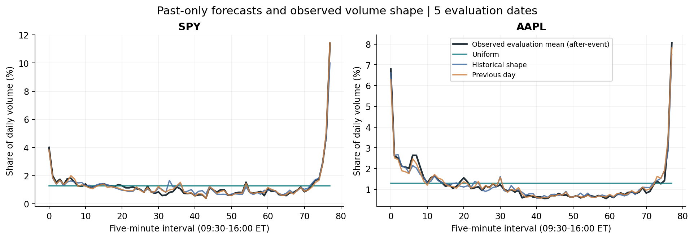
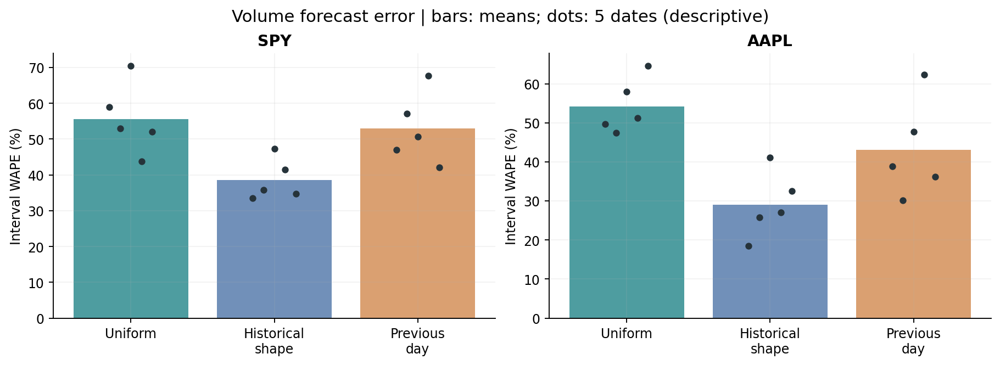
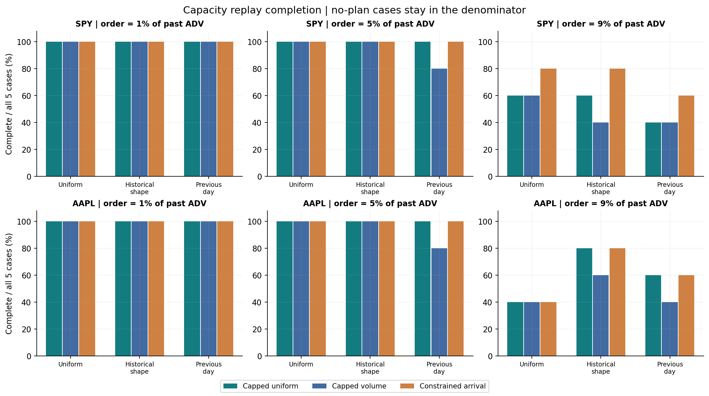
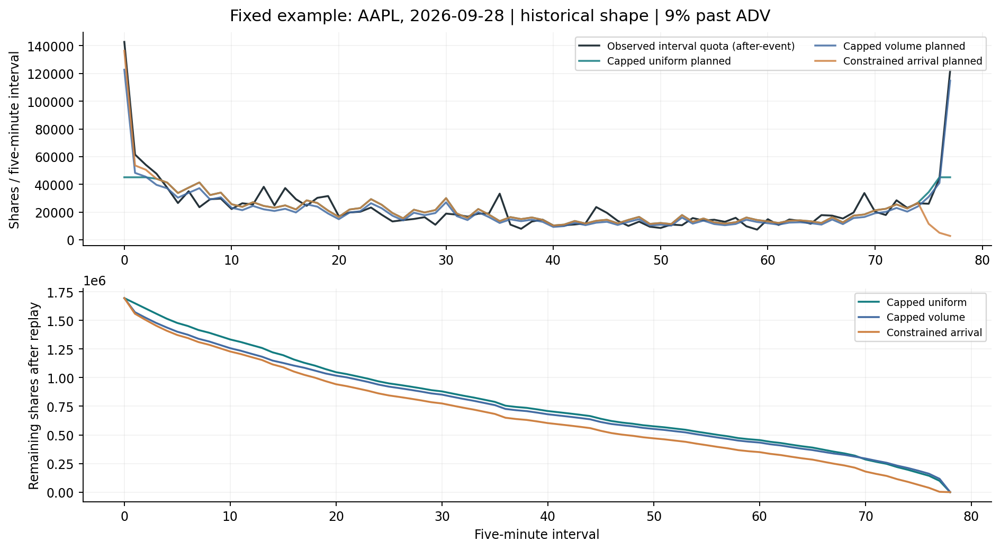
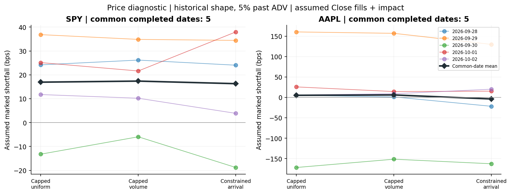

# 真实股票与 ETF 成交量验证

数据来自 [FirstRate Data](https://firstratedata.com/free-intraday-data), [format and permissions](https://firstratedata.com/about/FAQ), [license](https://firstratedata.com/about/license)。标的：SPY, AAPL；冻结数据期 2026-09-21—2026-10-02，数据取得日期：2026-10-09，报告整理日期：2026-10-10。接收 20 个完整标的交易日、7,800 条常规时段分钟记录，每天合并为78个五分钟区间。

## 研究问题与方法
重点是展示从真实行情到可复现研究的流程：数据校验、交易时段处理、只用过去日期预测、生成整数约束计划，再用后续日期评估。

每个目标日只用此前 5 个已经结束的交易日。共有 5 个评估日期、2 个标的、10 个标的评估日。后续窗口可以纳入此前已结束的评估日，不读取当日价格或成交量来制订计划。训练日期逐条保留，便于检查未来信息泄漏。

三种预测是均匀曲线、等权历史日内占比均值、前一日成交量。前两种共享历史平均日量；所有预测方法共用按过去 ADV 确定的订单规模：1%, 5%, 9%，区间参与率上限 10%。三种计划是约束下的均匀目标、预测成交量目标和到达价优化目标。波动率只从训练期日内价格变化估计；假设 eta=1e-05、lambda=1e-05，未校准真实交易冲击。

## 正式结果
30 条预测、270 条策略条件记录。264 条生成计划，229 条在回放中完成；35 条留下未完成数量；另有 6 条在预测容量检查时即明确无计划。相同日期上的不同条件、预测和策略不是独立市场样本，不能把 270 条记录当作 270 个独立观察。

| Instrument | Predictor | Mean daily APE | Mean interval WAPE | Mean cumulative share MAE |
|---|---|---:|---:|---:|
| SPY | Uniform | 10.05% | 55.64% | 8.25% |
| SPY | Historical shape | 10.05% | 38.56% | 6.30% |
| SPY | Previous day | 11.39% | 52.94% | 8.54% |
| AAPL | Uniform | 16.00% | 54.19% | 9.17% |
| AAPL | Historical shape | 16.00% | 29.02% | 3.06% |
| AAPL | Previous day | 19.75% | 43.06% | 4.27% |

区间 WAPE 是各段绝对预测误差之和除以实际全天成交量；日量 APE 衡量全天总量误差，累计占比 MAE 衡量日内形状误差。这些都是样本中的描述性平均值，不是统计置信区间。预测误差更小，不代表一定更便宜或能按时完成。均匀预测下，约束均匀目标和成交量目标可能相同，不构成额外独立证据。

| Instrument | Predictor | Order / past ADV | TWAP complete / 5 | Volume complete / 5 | Arrival complete / 5 | Common complete dates |
|---|---|---:|---:|---:|---:|---:|
| SPY | Uniform | 1% | 5 | 5 | 5 | 5 |
| SPY | Uniform | 5% | 5 | 5 | 5 | 5 |
| SPY | Uniform | 9% | 3 | 3 | 4 | 3 |
| SPY | Historical shape | 1% | 5 | 5 | 5 | 5 |
| SPY | Historical shape | 5% | 5 | 5 | 5 | 5 |
| SPY | Historical shape | 9% | 3 | 2 | 4 | 2 |
| SPY | Previous day | 1% | 5 | 5 | 5 | 5 |
| SPY | Previous day | 5% | 5 | 4 | 5 | 4 |
| SPY | Previous day | 9% | 2 | 2 | 3 | 2 |
| AAPL | Uniform | 1% | 5 | 5 | 5 | 5 |
| AAPL | Uniform | 5% | 5 | 5 | 5 | 5 |
| AAPL | Uniform | 9% | 2 | 2 | 2 | 2 |
| AAPL | Historical shape | 1% | 5 | 5 | 5 | 5 |
| AAPL | Historical shape | 5% | 5 | 5 | 5 | 5 |
| AAPL | Historical shape | 9% | 4 | 3 | 4 | 3 |
| AAPL | Previous day | 1% | 5 | 5 | 5 | 5 |
| AAPL | Previous day | 5% | 5 | 4 | 5 | 4 |
| AAPL | Previous day | 9% | 3 | 2 | 3 | 2 |

完成率分母保留所有评估日，无计划没有被删除。计划超出实际区间上限与回放违规是两回事：回放会截断每段成交量并保留剩余订单，不能用计划成功生成代替按期完成。

## 回放和成本口径
每段取“累计计划释放量减去此前已成交量”和“实际区间量乘参与率后向下取整”的较小值。未成交量延后，不能事后使用错过的早段容量，也没有重新优化剩余订单。实际容量总和只给出事后容量上界。完整区间量事后才知道，所以这是容量诊断，不能证明真实市场当时可以成交。

价格诊断假设每段在五分钟收盘价成交，再加固定冲击项。卖单短差分开保留已成交价格项、剩余订单期末盯市项和假设冲击项。盯市没有把剩余订单变成已完成成交。成本比较仅使用同一预测与规模下，三种计划均生成且均完成的共同日期，并显示日期数。不同预测的共同日期可能不同，不能直接按其均值排名。负短差可能只是价格变动有利，不能称为策略超额收益或已验证盈利。

下表是历史平均预测、5%过去 ADV 订单在共同完成日期上的固定计划冲击敏感性，单位bps。计划保持不变，没有声称重新优化或实证校准 eta。

| Instrument | Planner | Common complete dates | eta=0 | eta=1e-5 | eta=5e-5 |
|---|---|---:|---:|---:|---:|
| SPY | Capped uniform | 5 | 16.460 | 16.937 | 18.847 |
| SPY | Capped volume | 5 | 16.544 | 17.382 | 20.737 |
| SPY | Constrained arrival | 5 | 15.340 | 16.306 | 20.168 |
| AAPL | Capped uniform | 5 | 4.369 | 5.122 | 8.137 |
| AAPL | Capped volume | 5 | 4.746 | 6.004 | 11.036 |
| AAPL | Constrained arrival | 5 | -6.395 | -3.853 | 6.316 |

## 研究局限与复现
样本短、标的经过选择，不做显著性检验、年化或长期有效性推断。供应商日内量可能与官方日度总量不同，完整综合行情覆盖未独立验证。OHLC不能还原真实逐笔VWAP、价差、盘口或排队；也没有区分开收盘竞价执行。假设自己的订单不会改变历史价格与成交量，价格按供应商历史调整口径使用。连续松弛的最优性界不是整数全局最优证明。

原始行情、原始价格/成交量数组和供应商页面留在本地，不进入公开成果包。公开包包含代码、衍生指标、策略计划与静态研究图。复现者从官网自行取得数据，锁定的来源哈希会拒绝轮换或修订的免费样本；不同输入应另立设计版本。[复现说明](../../docs/real-volume.md)。

代码和研究准备使用 AI 辅助。

## 五张研究图

